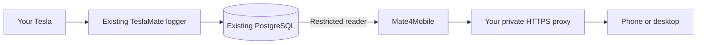

<div align="center">


[](https://itchyparrot53.github.io/mate4mobile/) [](https://itchyparrot53.github.io/mate4mobile/demo/) [](#getting-started)

[](https://github.com/itchyparrot53/mate4mobile/commits/main/) [](https://github.com/itchyparrot53/mate4mobile/stargazers) [](LICENSE)

</div>

## What is Mate4Mobile?

**TeslaMate records it. Mate4Mobile gives it a home on your phone.**

Your battery, journeys and charging in a private, self-hosted dashboard that feels at home on your Home Screen. Connect it to your existing TeslaMate installation; your logger keeps doing what it does best.

<p align="center">
  <a href="https://itchyparrot53.github.io/mate4mobile/demo/">
    
  </a>
</p>

<p align="center"><sub>Preview with synthetic data · <a href="https://itchyparrot53.github.io/mate4mobile/demo/">Try the interactive demo</a></sub></p>

<a id="getting-started"></a>

## Get started

You’ll need an existing TeslaMate PostgreSQL database, a Linux host with Docker Compose v2, and `git`, `bash` and `openssl`.

**1. Run the guided installer** on your TeslaMate Docker host. Copy this whole block:

```bash
git clone https://github.com/itchyparrot53/mate4mobile.git &&
cd mate4mobile &&
bash scripts/setup.sh
```

**2. Choose your database.** Setup lists your containers and networks. Select the PostgreSQL container, its network and database owner. It creates a restricted reader and starts Mate4Mobile separately, leaving your logger running.

**3. Open it on your phone.** Follow the [HTTPS setup guide](docs/HTTPS.md) to connect a private HTTPS address to `127.0.0.1:8099`. Sign in using `APP_PASS` from the generated `.env`, then choose **Add to Home Screen**.

**Already installed?** Use the [upgrade guide](docs/OPERATIONS.md).

<details>
<summary><strong>Installation help, passphrase and alternative setups</strong></summary>

The installer targets the standard TeslaMate Docker layout. You need permission to use Docker and connect as the existing PostgreSQL database owner for one-time reader creation. It generates app credentials; no Tesla API token is needed.

**Find your PostgreSQL container:**

```bash
docker ps --format 'table {{.Names}}\t{{.Image}}'
```

Choose the PostgreSQL container, not the TeslaMate application. The interactive installer then shows the networks attached to it. For a walkthrough, see [installation](docs/INSTALL.md).

**Supply known names and a currency:**

```bash
bash scripts/setup.sh \
  --container teslamate-database-1 \
  --network teslamate_default \
  --db-admin teslamate \
  --timezone Europe/London \
  --currency GBP
```

Replace the example names with yours. Setup refuses to overwrite an existing `.env` or take over an existing database role.

**Find your dashboard passphrase locally:**

```bash
sed -n 's/^APP_PASS=//p' .env
```

Keep the passphrase and `.env` private. HTTPS is required with the default Secure cookie. Your private dashboard runs on your server; GitHub Pages hosts only the showcase and synthetic demo.

**Not using Docker?** Follow the [native Node/systemd guide](docs/NATIVE.md).

</details>

## Explore the app

<a id="screenshots"></a>

<details>
<summary><strong>More screenshots — charging and desktop</strong></summary>

<p align="center">
  
</p>

**On desktop**


*Screenshots and the demo use invented data. Tesla vehicle renders are used for identification and illustration; see [attribution](docs/legal/LEGAL.md).*

</details>

<a id="features"></a>

<details>
<summary><strong>What each screen offers</strong></summary>

| View | What you get |
| --- | --- |
| **Vehicle** | Latest recorded battery, range, climate and location; today’s distance, driving time and charging; configurable vehicle imagery. |
| **Activity** | Drives and charges in one timeline, grouped by local date with details a tap away. |
| **Journeys** | Route maps and linked speed, power and battery charts. Scrub through a drive to follow the recorded position. |
| **Charging** | Energy or spend over a week, month or three months; location breakdowns, charging curves and cost coverage. |
| **Energy** | Driving totals and clearly labelled battery estimates that build context as your history grows. |
| **Every screen** | Responsive desktop layouts, mobile sheets, keyboard navigation, reduced-motion support and an installable PWA shell. |

</details>

<details>
<summary><strong>Currency, vehicle appearance and other settings</strong></summary>

**Currency and timezone** are configured in `.env`:

```dotenv
CURRENCY=GBP
TZ=Europe/London
```

Use `EUR`, `USD`, `CAD`, `AUD`, `JPY` or another supported currency. This formats stored amounts; it does not convert them. See [configuration](docs/CONFIGURATION.md#currency) for all options and how to apply changes.

**Vehicle and units** are in the app’s Preferences. Choose from seven model/generation presets and 39 paint choices, plus miles or kilometres. These settings stay on your device; imagery represents a model, not an exact VIN configuration.

**Brand assets** are available in the [brand kit](brand/README.md) and [visual brand board](https://itchyparrot53.github.io/mate4mobile/brand/).

</details>

## Guides & support

[Installation](docs/INSTALL.md) · [Troubleshooting](docs/TROUBLESHOOTING.md) · [Report a bug](https://github.com/itchyparrot53/mate4mobile/issues/new/choose)

<a id="faq"></a>

<details>
<summary><strong>Frequently asked questions</strong></summary>

### Does this replace TeslaMate or wake the car?

No. TeslaMate remains your logger. Mate4Mobile reads its PostgreSQL records and does not call Tesla’s API or send commands to the car. Readings are as recent as the data TeslaMate has recorded.

### Does GitHub Pages host my private dashboard?

No. Pages hosts the public website and a demo with synthetic data. Your dashboard runs on your own server, connected to your database. Publishing this repository does not upload your driving history.

### How do I install it on my phone?

Open your private HTTPS address in Safari on iPhone or a supported browser on Android, sign in and use Add to Home Screen or Install app. Your phone must trust the HTTPS certificate. Follow the [HTTPS and PWA guide](docs/HTTPS.md) for the full setup.

### Can I choose my model and paint colour?

Yes. Preferences includes seven model/generation presets and 39 colour choices. These are representative vehicle renders, not exact VIN configurations. Your selection stays on your device.

### Does it work offline?

The installed shell and selected illustrations can load offline. Fresh readings require access to your server; private API responses are not stored in the service worker cache. An already-open page may retain its current readings in memory.

### Why are some costs or battery figures missing?

The app keeps missing data visible rather than treating it as zero. Recorded charging costs are separate from estimates using your current tariff, and battery capacity and full-range figures are estimates. More driving and charging history gives them context. See the [data guide](docs/DATA.md).

</details>

<details>
<summary><strong>How it works, privacy and data limits</strong></summary>



**GitHub Pages hosts the showcase and synthetic demo only.** Your private dashboard runs on your own server; no GitHub workflow connects to your database.

- The installer grants `SELECT` on ten named telemetry/configuration tables. It does **not** grant access to TeslaMate’s `tokens` table, all tables or future tables.
- The backend uses read-only database transactions. The doctor checks effective grants, including privileges inherited through `PUBLIC`.
- Sessions use signed, expiring, HttpOnly cookies and login throttling. Production deployments should stay on a trusted LAN or private VPN behind HTTPS.
- Private API responses are not stored in the service worker cache. The shell and selected illustrations can load offline; fresh readings require your server. An already-open page may retain its current readings in memory.
- There are no analytics scripts or external fonts. Opening a route map requests OpenStreetMap tiles and shares the requested map area and your network address with that provider.
- Missing values remain missing. Recorded spend is separate from the current tariff. Battery capacity and full-range figures are estimates, not a battery diagnostic.

Read the [security model](.github/SECURITY.md), [data guide](docs/DATA.md) and [architecture](docs/ARCHITECTURE.md).

</details>

<a id="documentation"></a>

<details>
<summary><strong>All documentation</strong></summary>

| Guide | What it covers |
| --- | --- |
| [Installation](docs/INSTALL.md) · [Native installation](docs/NATIVE.md) | Add Mate4Mobile to an existing deployment. |
| [HTTPS & PWA](docs/HTTPS.md) | Private access, certificates and Home Screen installation. |
| [Configuration](docs/CONFIGURATION.md) | Environment variables and deployment options. |
| [Troubleshooting](docs/TROUBLESHOOTING.md) | Diagnose startup, database and connection issues. |
| [Operations](docs/OPERATIONS.md) | Upgrades, backups and removal. |
| [Data guide](docs/DATA.md) · [Architecture](docs/ARCHITECTURE.md) | Understand the readings and how the app works. |
| [Security](.github/SECURITY.md) | Access controls, privacy and vulnerability reporting. |
| [Publishing](docs/PUBLISHING.md) | GitHub Desktop and GitHub Pages setup. |
| [Brand kit](brand/README.md) | Logos, icons, colours and usage guidance. |
| [Release checklist](docs/RELEASE.md) · [Changelog](docs/CHANGELOG.md) | Validation record and release history. |

</details>

<details>
<summary><strong>Development, contributing and project status</strong></summary>

Node **22 or newer** is required; the container uses Node 24 LTS. The app is plain JavaScript and Node HTTP with PostgreSQL—no frontend framework or production build step.

```bash
npm ci
npm test
npm run site
npm run preview
```

Open `http://localhost:4173/mate4mobile/` for the website and demo. A database is not needed for these commands. For the private app, supply your own restricted database credentials as described in [CONTRIBUTING.md](.github/CONTRIBUTING.md).

### All development commands

| Command | Purpose |
| --- | --- |
| `npm start` | Start the private app; environment variables must be loaded. |
| `npm test` | Run data, authentication, chart, asset and service-worker regressions. |
| `npm run brand` | Regenerate Mate4Mobile brand artwork and icon exports; preserve vehicle renders. |
| `npm run site` | Build the Pages site and isolated demo into `dist/site`. |
| `npm run preview` | Serve the showcase locally, including its project subpath. |
| `npm run check` | Check release content, local links, icons and demo isolation. |
| `npm run test:install` | Test the installer and image with disposable Docker PostgreSQL. |
| `npm run doctor` | Read-only database configuration and privilege checks. |

An early public release, developed from a running personal installation. The public installer targets the standard single-database TeslaMate Docker layout. Native deployments are documented separately. Review the [validation record](docs/RELEASE.md) for what has actually been tested; unusual database schemas and proxy topologies may need configuration.

Bug reports and focused improvements are welcome. Please use synthetic examples and remove locations, VINs and credentials before sharing an issue.

Start with [CONTRIBUTING.md](.github/CONTRIBUTING.md), [report a bug](https://github.com/itchyparrot53/mate4mobile/issues/new/choose) or open a pull request with a focused improvement.

</details>

## Star history

<a href="https://www.star-history.com/#itchyparrot53/mate4mobile&Date">
  <picture>
    <source media="(prefers-color-scheme: dark)" srcset="https://api.star-history.com/svg?repos=itchyparrot53/mate4mobile&amp;type=Date&amp;theme=dark">
    <source media="(prefers-color-scheme: light)" srcset="https://api.star-history.com/svg?repos=itchyparrot53/mate4mobile&amp;type=Date">
    
  </picture>
</a>

---

Code and original branding: [MIT](LICENSE). Vehicle imagery: [separate rights and attribution](docs/legal/LEGAL.md). Independent of Tesla and TeslaMate.

<details>
<summary><strong>Credits and third-party licences</strong></summary>

Made possible by [TeslaMate](https://github.com/teslamate-org/teslamate), [Leaflet](https://leafletjs.com/), [OpenStreetMap](https://www.openstreetmap.org/copyright), [Inter](https://rsms.me/inter/) and [node-postgres](https://node-postgres.com/).

Mate4Mobile code and original brand artwork are [MIT licensed](LICENSE). Tesla vehicle imagery is excluded from that licence; see [LEGAL.md](docs/legal/LEGAL.md). Bundled third-party components retain their own licences; see [THIRD_PARTY_NOTICES.md](docs/legal/THIRD_PARTY_NOTICES.md).

Mate4Mobile is independent and is not affiliated with, endorsed by or sponsored by Tesla, Inc. or the TeslaMate project. Tesla, Model 3, Model Y, Model S and Model X are trademarks of their respective owners.

</details>
