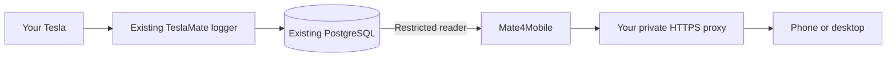

<p align="center"></p>

<p align="center"><strong>Your private TeslaMate companion.</strong><br>Journeys, charging and battery history—made for your phone.</p>

<p align="center"><a href="https://itchyparrot53.github.io/mate4mobile/">Website</a> · <a href="https://itchyparrot53.github.io/mate4mobile/demo/">Try the demo</a> · <a href="docs/INSTALL.md">Install</a> · <a href="docs/HTTPS.md">HTTPS & PWA</a> · <a href="brand/README.md">Brand kit</a></p>

---

TeslaMate records the story of your car. **Mate4Mobile makes it easy to read.**

Open it for a quick battery check. Scroll through your day. Follow a journey on the map or see what a charge actually added. A restrained dark interface, large readings and touch-friendly charts keep the useful information close.

Mate4Mobile is a separate, self-hosted viewer for your existing TeslaMate database. It does not replace TeslaMate, collect telemetry, connect to Tesla’s API or send vehicle commands.

## A better daily view

| View | What you get |
| --- | --- |
| **Vehicle** | Latest recorded battery, range, climate and location; today’s distance, driving time and charging; configurable vehicle imagery. |
| **Activity** | Drives and charges in one timeline, grouped by local date with details a tap away. |
| **Journeys** | Route maps and linked speed, power and battery charts. Scrub through a drive to follow the recorded position. |
| **Charging** | Energy or spend over a week, month or three months; location breakdowns, charging curves and cost coverage. |
| **Energy** | Driving totals and clearly labelled battery estimates that build context as your history grows. |
| **Every screen** | Responsive desktop layouts, mobile sheets, keyboard navigation, reduced-motion support and an installable PWA shell. |

<p align="center"> </p>

*Screenshots and the public demo use invented data. Vehicle renders © Tesla, Inc. and/or their respective owners; used for identification and illustration. See [LEGAL.md](LEGAL.md).*

<details><summary><strong>A closer look on desktop</strong></summary>


</details>

## Start with the demo

**[Explore Mate4Mobile](https://itchyparrot53.github.io/mate4mobile/demo/)** without a server, sign-in or vehicle connection. It runs the app interface against synthetic readings. Nothing in the demo can reach your car or database.

## Install alongside TeslaMate

You need an existing TeslaMate PostgreSQL database, a Linux Docker host with Compose v2, `git`, `bash` and `openssl`, and a private HTTPS address for phone installation.

```bash
git clone https://github.com/itchyparrot53/mate4mobile.git
cd mate4mobile
bash scripts/setup.sh
```

The guided setup asks for your existing PostgreSQL container and network. It creates a **new restricted reader**, generates credentials in a local `.env`, checks the database privileges and starts a **separate Mate4Mobile container**. It does not edit your TeslaMate Compose file, restart the logger or migrate its tables.

The app initially listens on **host loopback port 8099**. Add your HTTPS reverse proxy, open that address on your phone and add it to the Home Screen. HTTPS is required for the default secure session cookie and reliable PWA installation.

**[Complete installation guide](docs/INSTALL.md)** · **[HTTPS and Home Screen setup](docs/HTTPS.md)** · **[Native Node/systemd installation](docs/NATIVE.md)**

Already know your container names?

```bash
bash scripts/setup.sh \
  --container teslamate-database-1 \
  --network teslamate_default \
  --db-admin teslamate \
  --timezone Europe/London \
  --currency GBP
```

Replace the example container and network names with yours. Setup refuses to overwrite an existing `.env` or take over an existing database role. Existing installations should use the [upgrade guide](docs/OPERATIONS.md).

## How it fits



**GitHub Pages hosts the showcase and synthetic demo only.** Your private dashboard runs on your own server; no GitHub workflow connects to your database.

## Private by design, precise about the data

- The installer grants `SELECT` on ten named telemetry/configuration tables. It does **not** grant access to TeslaMate’s `tokens` table, all tables or future tables.
- The backend uses read-only database transactions. The doctor checks effective grants, including privileges inherited through `PUBLIC`.
- Sessions use signed, expiring, HttpOnly cookies and login throttling. Production deployments should stay on a trusted LAN or private VPN behind HTTPS.
- Private API responses are not stored in the service worker cache. The shell and selected illustrations can load offline; fresh readings require your server. An already-open page may retain its current readings in memory.
- There are no analytics scripts or external fonts. Opening a route map requests OpenStreetMap tiles and shares the requested map area and your network address with that provider.
- Missing values remain missing. Recorded spend is separate from the current tariff. Battery capacity and full-range figures are estimates, not a battery diagnostic.

Read the [security model](SECURITY.md), [data guide](docs/DATA.md) and [architecture](docs/ARCHITECTURE.md).

## Make it yours

Choose a vehicle family, generation and paint in Preferences. Seven model/generation presets and 39 colour choices use the same Tesla renders as the app. Year ranges and representative trims are guides, not exact VIN configurations. Preferences and distance units stay on the device.

The [brand kit](brand/README.md) includes SVG masters, light/dark wordmarks, a compact M4M lockup, favicons, maskable PWA icons, Apple touch icons, social artwork, design tokens and usage guidance. The [visual brand board](https://itchyparrot53.github.io/mate4mobile/brand/) brings it together.

## Develop locally

Node **22 or newer** is required; the container uses Node 24 LTS. The app is plain JavaScript and Node HTTP with PostgreSQL—no frontend framework or production build step.

```bash
npm ci
npm test
npm run site
npm run preview
```

Open `http://localhost:4173/mate4mobile/` for the website and demo. A database is not needed for these commands. For the private app, supply your own restricted database credentials as described in [CONTRIBUTING.md](CONTRIBUTING.md).

| Command | Purpose |
| --- | --- |
| `npm start` | Start the private app; environment variables must be loaded. |
| `npm test` | Run data, authentication, chart, asset and service-worker regressions. |
| `npm run brand` | Regenerate Mate4Mobile brand artwork and icon exports; preserve vehicle renders. |
| `npm run site` | Build the Pages site and isolated demo into `dist/site`. |
| `npm run preview` | Serve the showcase locally, including its project subpath. |
| `npm run check` | Check release content, local links, icons and demo isolation. |
| `npm run test:install` | Test the installer and image with disposable Docker PostgreSQL. |
| `npm run doctor` | Read-only database configuration and privilege checks. |

## Documentation

- [Installation](docs/INSTALL.md), [native installation](docs/NATIVE.md) and [HTTPS/PWA](docs/HTTPS.md)
- [Configuration reference](docs/CONFIGURATION.md) and [troubleshooting](docs/TROUBLESHOOTING.md)
- [Upgrades, backups and removal](docs/OPERATIONS.md)
- [Data definitions and limits](docs/DATA.md)
- [Publishing the repository and GitHub Pages](docs/PUBLISHING.md)
- [Release checklist](docs/RELEASE.md), [changelog](CHANGELOG.md) and [contributing](CONTRIBUTING.md)

## Project status

An early public release, developed from a running personal installation. The public installer targets the standard single-database TeslaMate Docker layout. Native deployments are documented separately. Review the [validation record](docs/RELEASE.md) for what has actually been tested; unusual database schemas and proxy topologies may need configuration.

Bug reports and focused improvements are welcome. Please use synthetic examples and remove locations, VINs and credentials before sharing an issue.

## Credits and licence

Made possible by [TeslaMate](https://github.com/teslamate-org/teslamate), [Leaflet](https://leafletjs.com/), [OpenStreetMap](https://www.openstreetmap.org/copyright), [Inter](https://rsms.me/inter/) and [node-postgres](https://node-postgres.com/).

Mate4Mobile code and original brand artwork are [MIT licensed](LICENSE). Tesla vehicle imagery is excluded from that licence; see [LEGAL.md](LEGAL.md). Bundled third-party components retain their own licences; see [THIRD_PARTY_NOTICES.md](THIRD_PARTY_NOTICES.md).

Mate4Mobile is independent and is not affiliated with, endorsed by or sponsored by Tesla, Inc. or the TeslaMate project. Tesla, Model 3, Model Y, Model S and Model X are trademarks of their respective owners.
